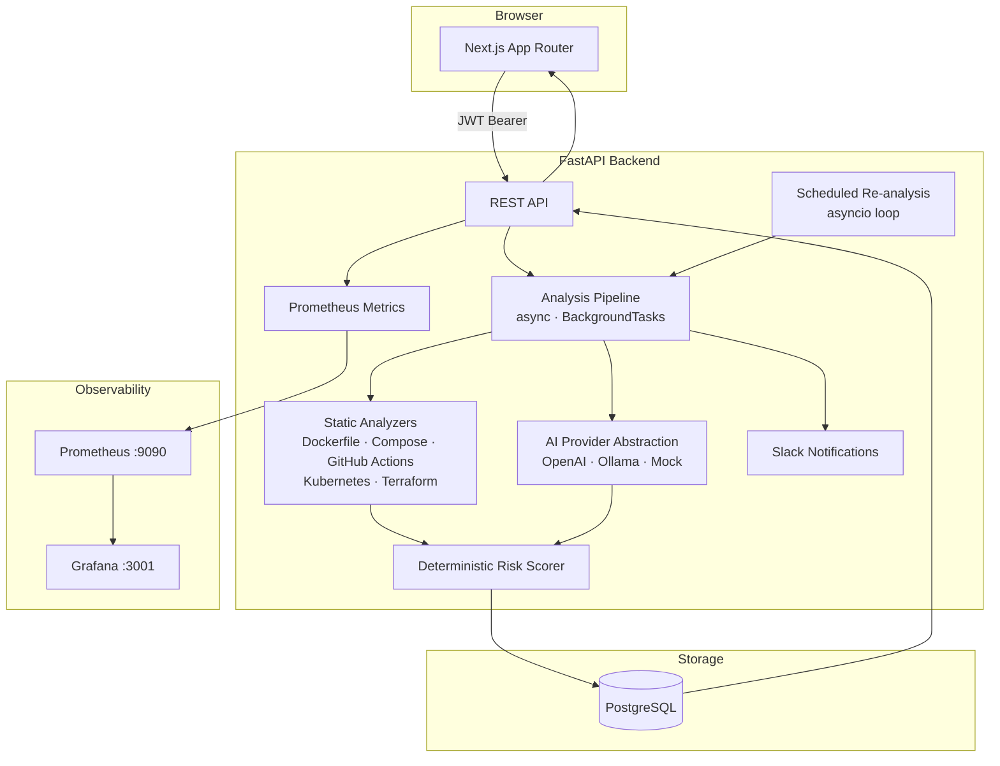
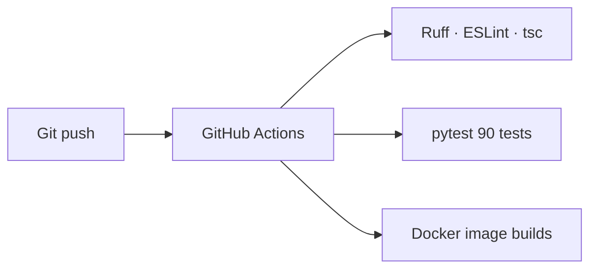

# AI DevOps Configuration Reviewer

A full-stack web application that reviews DevOps configuration files for security vulnerabilities, reliability issues, and bad practices. It combines deterministic static analysis with schema-validated LLM reasoning so developers get structured, explainable findings — not just raw AI text.

## What it does

A developer submits a Dockerfile, Docker Compose file, GitHub Actions workflow, Kubernetes manifest, or Terraform configuration. The system:

1. Runs deterministic rule-based checks (5–15 focused rules per type)
2. Returns static findings immediately (HTTP 202) while AI analysis runs in the background
3. Sends the configuration and those findings to an LLM with a structured prompt
4. Validates the LLM response against a Pydantic schema
5. Calculates a deterministic risk score (never delegated to the AI)
6. Persists findings and serves them through a typed REST API
7. Displays results in a dashboard with severity badges, category filters, confidence threshold slider, and full history
8. Optionally exports findings as a SARIF file for GitHub Code Scanning
9. Optionally posts a Slack notification when analysis completes

This demonstrates why combining deterministic analysis with AI is better than using an LLM alone: rules catch known patterns reliably; AI adds contextual reasoning, subtle issues, and actionable recommendations.

## Architecture





## Tech stack

| Layer | Technology |
|---|---|
| Frontend | Next.js 16 (App Router), React 19, TypeScript 5, Tailwind CSS v4 |
| Backend | Python 3.12, FastAPI, Pydantic v2, SQLAlchemy 2 (async) |
| Database | PostgreSQL 16, Alembic migrations, asyncpg |
| Auth | JWT (PyJWT), Argon2 password hashing (pwdlib) |
| AI | OpenAI Responses API / Ollama — provider abstraction, strict JSON schema |
| Observability | Structured JSON logs, Prometheus metrics at `/metrics`, Grafana dashboards |
| Notifications | Slack webhook (opt-in via `SLACK_WEBHOOK_URL`) |
| Security | Security headers middleware, `slowapi` rate limiting |
| CI/CD | GitHub Actions (lint → test → Docker build) |
| Containerisation | Docker, Docker Compose |

## Quick start

```bash
cp .env.example .env
# Edit .env — set SECRET_KEY and optionally OPENAI_API_KEY
docker compose up --build
```

| Service | URL |
|---|---|
| Frontend | http://localhost:3000 |
| Backend API | http://localhost:8000 |
| API docs | http://localhost:8000/docs |
| Prometheus metrics | http://localhost:8000/metrics |
| Prometheus UI | http://localhost:9090 |
| Grafana | http://localhost:3001 (admin / `GRAFANA_ADMIN_PASSWORD`) |

> The backend Docker image runs `alembic upgrade head` automatically before starting, so no manual migration step is needed.

## Environment variables

| Variable | Required | Default | Description |
|---|---|---|---|
| `SECRET_KEY` | **yes** | — | JWT signing key, minimum 32 characters |
| `DATABASE_URL` | yes | see `.env.example` | asyncpg connection string |
| `AI_PROVIDER` | no | `openai` | `openai` or `ollama` |
| `OPENAI_API_KEY` | for OpenAI | — | OpenAI API key |
| `OPENAI_MODEL` | no | `gpt-4.1-mini` | OpenAI model name |
| `OLLAMA_BASE_URL` | for Ollama | `http://localhost:11434` | Ollama server URL |
| `OLLAMA_MODEL` | no | `llama3.2` | Ollama model name |
| `CORS_ORIGINS` | no | `http://localhost:3000` | Comma-separated allowed origins |
| `ACCESS_TOKEN_EXPIRE_MINUTES` | no | `30` | JWT lifetime |
| `LOG_LEVEL` | no | `INFO` | Logging level |
| `SLACK_WEBHOOK_URL` | no | — | Slack incoming webhook URL; omit to disable notifications |
| `SCHEDULED_REANALYSIS_INTERVAL_HOURS` | no | `0` | Re-analyze all configs every N hours; `0` disables |
| `GRAFANA_ADMIN_PASSWORD` | no | `admin` | Grafana admin password |

See `.env.example` for all variables including PostgreSQL settings.

## Local development (without Docker)

**Backend** — requires Python 3.12+:

```bash
cd backend
python -m venv .venv && source .venv/bin/activate   # or .venv\Scripts\activate on Windows
pip install -e ".[dev]"
alembic upgrade head
uvicorn app.main:app --reload
```

**Frontend** — requires Node.js 22+:

```bash
cd frontend
npm install
npm run dev
```

## Testing

```bash
# Backend (90 tests, no API key or database needed)
cd backend
pytest tests/ -v

# Frontend
cd frontend
npm run lint && npm run typecheck
```

All backend tests use an in-memory SQLite database and a `MockAIProvider`. No OpenAI API key is required.

## CI/CD

Three GitHub Actions jobs run on every push to `main` or `dev` and on every pull request to `main`:

1. **backend** — Ruff lint, Ruff format check, pytest
2. **frontend** — ESLint, TypeScript check, Next.js build
3. **docker** — builds both Docker images (runs only after backend and frontend pass)

## Deployment

The application is designed for [Render](https://render.com) or [Railway](https://railway.app).

**Render (recommended):**

1. Create a PostgreSQL instance. Copy the connection string.
2. Create a Web Service from this repository for the backend. Set build command to `pip install .` and start command to `alembic upgrade head && uvicorn app.main:app --host 0.0.0.0 --port $PORT`. Set all environment variables from `.env.example`.
3. Create a Web Service for the frontend. Set build command to `npm ci && npm run build` and start command to `npm start`. Set `NEXT_PUBLIC_API_BASE_URL` to the backend service URL.

**Railway:** Create a project, add a PostgreSQL plugin, and deploy backend and frontend as separate services using the same environment variables.

For both platforms:
- Generate a strong `SECRET_KEY`: `python -c "import secrets; print(secrets.token_hex(32))"`
- Set `CORS_ORIGINS` to the deployed frontend URL

## Supported configuration types

| Type | Rules | Key checks |
|---|---|---|
| Dockerfile | 9 | Root user, latest tag, secrets in ENV/ARG, layer count, missing HEALTHCHECK, unsafe package install |
| Docker Compose | 7 | Privileged containers, host networking, Docker socket mount, hard-coded secrets, missing restart policy |
| GitHub Actions | 7 | Unpinned actions, pull_request_target risks, excessive permissions, secrets in run steps, dangerous expressions |
| Kubernetes | 9 | Default namespace, host network/PID, unpinned images, privileged/root containers, missing resource limits, missing readiness probe |
| Terraform / HCL | 7 | Hard-coded secrets, open security groups, public S3 ACLs, unencrypted storage, missing provider version, unencrypted S3 backend, publicly accessible RDS |

## Risk scoring

Score = 100 − Σ(severity weight per finding), clamped to [0, 100].

| Severity | Weight |
|---|---|
| Critical | 10 |
| High | 7 |
| Medium | 4 |
| Low | 1 |

The score is always calculated by the backend. The AI never sets the final score.

## Documentation

- [Architecture](docs/ARCHITECTURE.md)
- [API reference](docs/API.md)
- [Security](docs/SECURITY.md)
- [Development guide](docs/DEVELOPMENT.md)
- [Contributing](docs/CONTRIBUTING.md)
