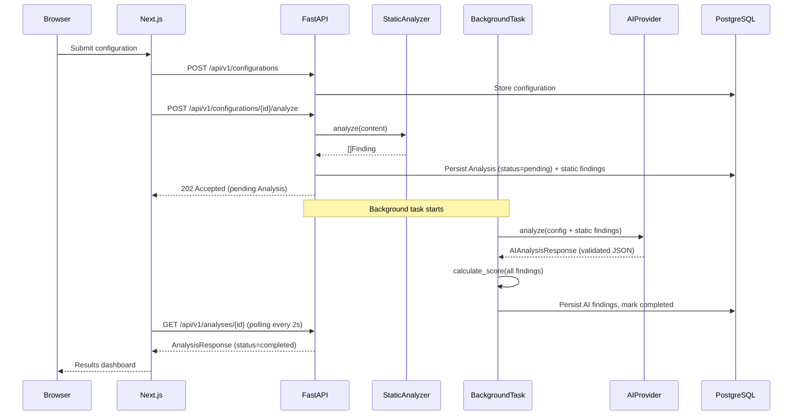
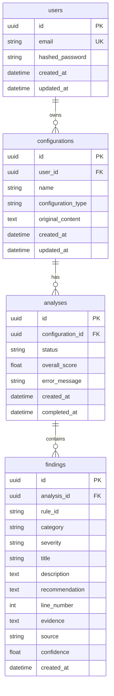
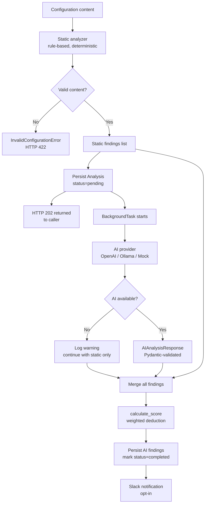
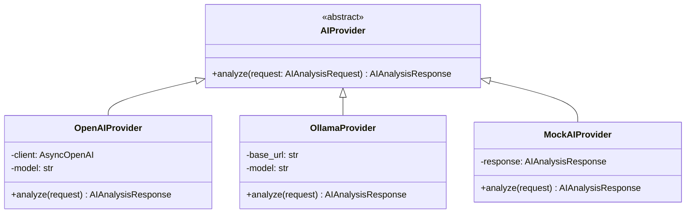
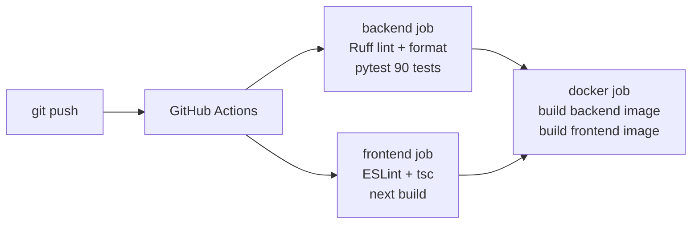

# Architecture

## Overview

The application is a three-tier monorepo: a Next.js frontend, a FastAPI backend, and a PostgreSQL database. All business logic lives in a single FastAPI application — no microservices, no message queues — to keep it maintainable for a solo developer.

An optional observability stack (Prometheus + Grafana) and a Slack webhook integration are available as opt-in services via environment variables.

## Request flow

Analysis creation uses a two-stage async pattern: the HTTP response returns immediately with static findings while AI analysis runs in the background.



## Backend module boundaries

```text
backend/app/
├── api/
│   ├── deps.py              — FastAPI dependencies (DB session, current user, AI provider)
│   └── routes/
│       ├── auth.py          — POST /register, POST /login, GET /me
│       ├── configurations.py — CRUD + POST /{id}/analyze (returns 202)
│       ├── analyses.py      — GET /analyses, GET /analyses/{id}, GET /analyses/{id}/sarif
│       └── health.py        — GET /health, GET /ready, GET /metrics
├── core/
│   ├── config.py            — Pydantic Settings (env-backed, validated at startup)
│   ├── security.py          — JWT creation and verification, Argon2 hashing
│   ├── logging.py           — JSON formatter, configure_logging()
│   ├── limiter.py           — slowapi Limiter singleton
│   └── metrics.py           — Prometheus Counter and Histogram definitions
├── middleware/
│   └── security.py          — SecurityHeadersMiddleware (X-Frame-Options, etc.)
├── models/                  — SQLAlchemy ORM models (User, Configuration, Analysis, FindingRecord)
├── schemas/                 — Pydantic request/response contracts
├── services/
│   ├── auth.py              — User creation, authentication
│   ├── configurations.py    — CRUD enforcing user ownership
│   ├── analyses.py          — Queries JOINing Analysis → Configuration for auth
│   ├── analysis_pipeline.py — Orchestrates static → AI → score → persist (sync + async stages)
│   ├── ai_analysis.py       — AIAnalysisService wrapping provider calls
│   ├── scoring.py           — calculate_score() — deterministic, never delegated to AI
│   ├── sarif.py             — analysis_to_sarif() — SARIF 2.1 export
│   ├── notifications.py     — notify_analysis_complete() — Slack webhook (opt-in)
│   └── scheduler.py         — start/stop asyncio task for periodic re-analysis
├── analyzers/               — Deterministic rule engines
│   ├── interface.py         — ConfigurationAnalyzer ABC + Finding + FindingSeverity
│   ├── dockerfile.py        — DockerfileAnalyzer (9 rules)
│   ├── compose.py           — ComposeAnalyzer (7 rules)
│   ├── github_actions.py    — GitHubActionsAnalyzer (7 rules)
│   ├── kubernetes.py        — KubernetesAnalyzer (9 rules, multi-doc YAML)
│   ├── terraform.py         — TerraformAnalyzer (7 rules, regex-based HCL)
│   └── factory.py           — get_analyzer(ConfigurationType) dispatch
├── ai/
│   ├── provider.py          — AIProvider ABC + AIProviderError
│   ├── schemas.py           — AIAnalysisRequest, AIAnalysisResponse (Pydantic)
│   ├── openai_provider.py   — OpenAI Responses API with strict JSON schema
│   ├── ollama_provider.py   — Ollama via httpx
│   ├── mock_provider.py     — MockAIProvider for tests
│   ├── factory.py           — get_ai_provider(settings) dispatch
│   └── prompts/             — Prompt templates per configuration type
├── db/
│   ├── base.py              — DeclarativeBase
│   └── session.py           — async_sessionmaker, get_db_session dependency
└── migrations/              — Alembic migration scripts
```

## Database schema



## Analysis pipeline



Key invariants:
- `calculate_score` is always called by the backend with deterministic weights. The AI never sets the overall score.
- The analysis row is written with `status=pending` before the HTTP response is sent, so callers can poll immediately.
- The background task opens its own database session — the request session is already closed by the time it runs.

## AI provider abstraction



The `AIProvider` ABC means the rest of the application never imports OpenAI or Ollama directly. Tests inject `MockAIProvider` via FastAPI dependency overrides with no real API calls.

## Observability

Prometheus scrapes `backend:8000/metrics` every 15 seconds. Grafana is auto-provisioned with a Prometheus datasource and a starter dashboard.

```text
observability/
├── prometheus.yml                          — scrape config
└── grafana/
    └── provisioning/
        ├── datasources/prometheus.yml      — auto-provisioned Prometheus datasource
        └── dashboards/
            ├── dashboards.yml              — dashboard provider config
            └── ai-devops-reviewer.json     — starter dashboard (RPS, latency, analyses, AI errors)
```

Tracked metrics:
- `http_requests_total` — counter by method, endpoint, status
- `http_request_duration_seconds` — histogram by method, endpoint
- `analyses_total` — counter of completed analyses
- `ai_provider_failures_total` — counter of AI provider errors

## Scheduler

A plain asyncio task loop (no APScheduler or Celery dependency) runs inside the FastAPI process, started and stopped via the `lifespan` context manager. When `SCHEDULED_REANALYSIS_INTERVAL_HOURS > 0` it calls the full analysis pipeline for every configuration on each tick, each in its own database session.

## CI/CD pipeline



Permissions are set to `contents: read` (least privilege). The Docker job only runs after both quality gates pass.

## Security model

- Passwords are hashed with Argon2 (via pwdlib). Plain-text passwords are never stored or logged.
- JWTs are signed with HS256. The signing key must be at least 32 characters and is validated at startup.
- Authorization is enforced at the database query level: analyses and configurations are fetched with a JOIN on `user_id`, so a user can never access another user's data even with a valid token.
- Security headers (`X-Content-Type-Options`, `X-Frame-Options`, `X-XSS-Protection`, `Referrer-Policy`, `Permissions-Policy`) are applied to every response via middleware.
- Auth endpoints are rate-limited per IP (20 registrations/minute, 30 logins/minute).
- All logs are structured JSON. Passwords, tokens, and API keys are never logged.
- SARIF export requires authentication — the JWT is passed in the `Authorization` header, not a URL query parameter, to avoid token leakage in server logs.
