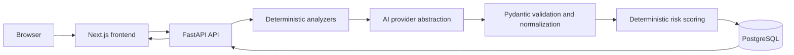
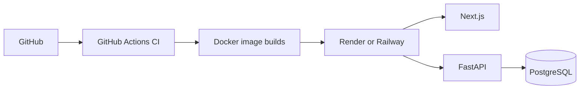

# Architecture

## Scope and approach

This project is a simple monorepo designed for a solo student developer. The frontend, backend, and database remain separate deployable services, but business logic stays in one FastAPI application rather than being split into microservices.

The core product flow, implemented incrementally after Phase 1, is:

Static analyzers identify known configuration violations. The AI layer adds contextual reasoning and recommendations but never supplies the final risk score unchecked. Its structured output is validated before it can be persisted.

Phase 3 implements 5–7 focused deterministic rules for each supported format. These rules are deliberately small and testable; they report validated `Finding` contracts rather than writing directly to the database. The analysis-pipeline phase will orchestrate them with AI, normalization, risk scoring, and persistence.

Phase 4 introduces an `AIProvider` interface. OpenAI and Ollama providers return only `AIAnalysisResponse`, which Pydantic validates before it can reach a later persistence phase. Provider errors and malformed outputs are explicit failures; no raw LLM output is stored. Dedicated prompts carry the configuration type and deterministic findings, while input and output limits control cost.

## Planned backend boundaries

- `api/`: versioned HTTP route handlers only.
- `services/`: orchestration and business rules.
- `analyzers/`: deterministic Dockerfile, Compose, and GitHub Actions checks.
- `ai/`: provider interface, prompts, response schemas, and providers.
- `models/` and `db/`: SQLAlchemy models, sessions, and Alembic migrations.
- `schemas/`: Pydantic request and response contracts.
- `core/`: configuration, security helpers, and safe logging.

This separation keeps route handlers thin and makes the analysis pipeline unit-testable.

## Deployment and CI target

Docker Compose is the local development baseline. Cloud deployment is intentionally documented later, once the working application exists.
