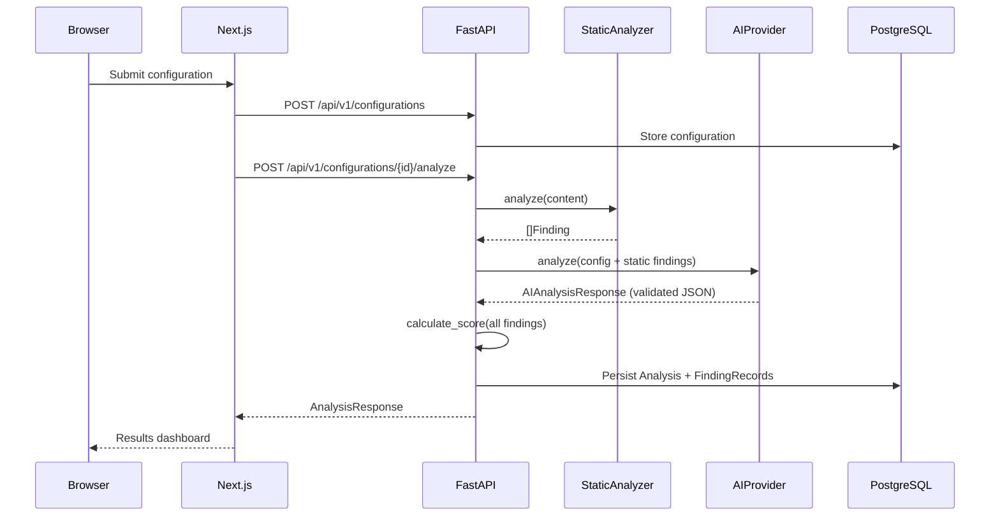
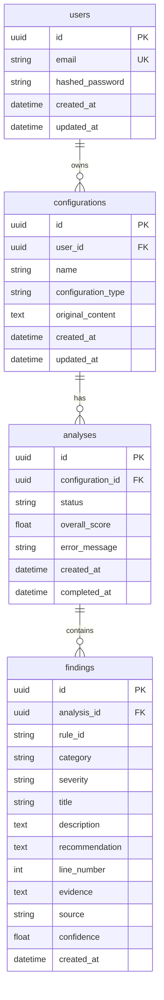
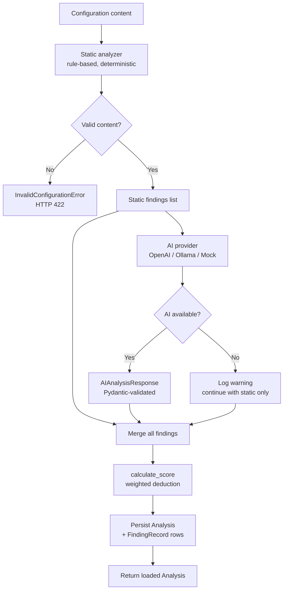
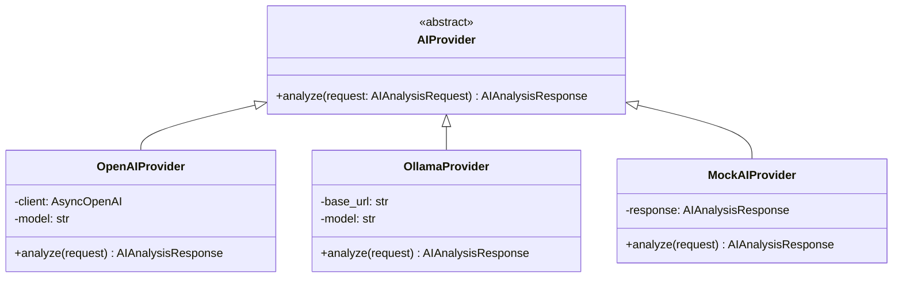

# Architecture

## Overview

The application is a three-tier monorepo: a Next.js frontend, a FastAPI backend, and a PostgreSQL database. All business logic lives in a single FastAPI application — no microservices, no message queues — to keep it maintainable for a solo developer.

## Request flow



## Backend module boundaries

```text
backend/app/
├── api/
│   ├── deps.py              — FastAPI dependencies (DB session, current user, AI provider)
│   └── routes/
│       ├── auth.py          — POST /register, POST /login, GET /me
│       ├── configurations.py — CRUD + POST /{id}/analyze
│       ├── analyses.py      — GET /analyses, GET /analyses/{id}
│       └── health.py        — GET /health, GET /ready, GET /metrics
├── core/
│   ├── config.py            — Pydantic Settings (env-backed, validated at startup)
│   ├── security.py          — JWT creation and verification, Argon2 hashing
│   ├── logging.py           — JSON formatter, configure_logging()
│   ├── limiter.py           — slowapi Limiter singleton
│   └── metrics.py           — Prometheus Counter and Histogram definitions
├── middleware/
│   └── security.py          — SecurityHeadersMiddleware (X-Frame-Options, etc.)
├── models/                  — SQLAlchemy ORM models (User, Configuration, Analysis, FindingRecord)
├── schemas/                 — Pydantic request/response contracts
├── services/
│   ├── auth.py              — User creation, authentication
│   ├── configurations.py    — CRUD enforcing user ownership
│   ├── analyses.py          — Queries JOINing Analysis → Configuration for auth
│   ├── analysis_pipeline.py — Orchestrates static → AI → score → persist
│   ├── ai_analysis.py       — AIAnalysisService wrapping provider calls
│   └── scoring.py           — calculate_score() — deterministic, never delegated to AI
├── analyzers/               — Deterministic rule engines
│   ├── interface.py         — ConfigurationAnalyzer ABC + Finding + FindingSeverity
│   ├── dockerfile.py        — DockerfileAnalyzer (8 rules)
│   ├── compose.py           — ComposeAnalyzer (7 rules)
│   ├── github_actions.py    — GitHubActionsAnalyzer (7 rules)
│   └── factory.py           — get_analyzer(ConfigurationType) dispatch
├── ai/
│   ├── provider.py          — AIProvider ABC + AIProviderError
│   ├── schemas.py           — AIAnalysisRequest, AIAnalysisResponse (Pydantic)
│   ├── openai_provider.py   — OpenAI Responses API with strict JSON schema
│   ├── ollama_provider.py   — Ollama via httpx
│   ├── mock_provider.py     — MockAIProvider for tests
│   ├── factory.py           — get_ai_provider(settings) dispatch
│   └── prompts/             — Prompt templates per configuration type
├── db/
│   ├── base.py              — DeclarativeBase
│   └── session.py           — async_sessionmaker, get_db_session dependency
└── migrations/              — Alembic migration scripts
```

## Database schema



## Analysis pipeline



Key invariant: `calculate_score` is always called by the backend with deterministic weights. The AI never sets the overall score.

## AI provider abstraction



The `AIProvider` ABC means the rest of the application never imports OpenAI or Ollama directly. Tests inject `MockAIProvider` via FastAPI dependency overrides with no real API calls.

## CI/CD pipeline


Permissions are set to `contents: read` (least privilege). The Docker job only runs after both quality gates pass.

## Security model

- Passwords are hashed with Argon2 (via pwdlib). Plain-text passwords are never stored or logged.
- JWTs are signed with HS256. The signing key must be at least 32 characters and is validated at startup.
- Authorization is enforced at the database query level: analyses and configurations are fetched with a JOIN on `user_id`, so a user can never access another user's data even with a valid token.
- Security headers (`X-Content-Type-Options`, `X-Frame-Options`, `X-XSS-Protection`, `Referrer-Policy`, `Permissions-Policy`) are applied to every response via middleware.
- Auth endpoints are rate-limited per IP (20 registrations/minute, 30 logins/minute).
- All logs are structured JSON. Passwords, tokens, and API keys are never logged.
